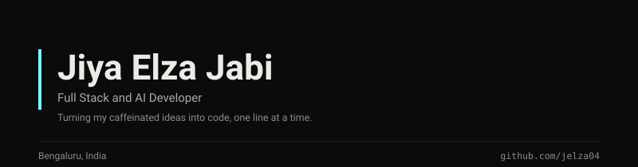
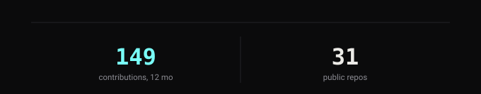
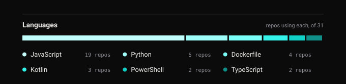

  
  
  
  

<picture>
  <source media="(prefers-color-scheme: dark)" srcset="assets/heatmap-dark.svg">
  <source media="(prefers-color-scheme: light)" srcset="assets/heatmap-light.svg">
  
</picture>

## About

I'm Jiya, a full-stack and AI engineer finishing my MCA at CHRIST University, Bengaluru. I like building things end to end, from the database to the screen, and I don't stop until the problem is actually solved.

I spent eight months at Iolite Technologies shipping web features and LLM-based search for enterprise clients. What I enjoy most is debugging systems I've never seen before, and measuring whether something works instead of assuming it does.

| | |
|---|---|
| Location | Bengaluru, India |
| Focus | Full-stack web, RAG and LLM applications |
| Currently | Finishing my MCA at CHRIST University |
| Previously | Iolite Technologies, 8 months |

## Work

### TADBuddy — AI wellness companion

A chat companion that responds to how you feel. Replies come from a retrieval-augmented (RAG) pipeline built in LangGraph, grounded in real counselling conversations, with long-term memory for each user. The model (Llama 3.2) runs locally, so no paid API is needed. Safety checks run on every sentence before the user sees it, and crisis messages skip the model entirely.

**Stack:** React · FastAPI · LangGraph · Ollama · Supabase (pgvector) · Redis · Docker

**Status:** Built and tested with a fake model; end-to-end run against the real database and model is next.

### AeroCrew — Airline crew recovery platform

When a pilot can't fly, the system finds a replacement who is legally allowed to fly and can reach the airport in time. I joined an existing codebase, found the core logic only existed in the frontend, and rebuilt it in the Java backend: checks against 9 DGCA duty-time rules, reachability estimates, and a 0–100 score to rank standby pilots. I also fixed the bugs stopping it from running and closed a security hole that let anyone create an admin account.

**Stack:** Java 21 · Spring Boot · Spring Security · PostgreSQL · React · Docker

## Stack

  

| Area | Tools |
|:---:|:---:|
| Languages | Python · Java · JavaScript · SQL |
| Frontend | React · Tailwind CSS · Zustand · TanStack Query |
| Backend | FastAPI · Spring Boot · REST APIs |
| Data | PostgreSQL · MySQL · MongoDB · Redis · pgvector |
| AI | LLM APIs (OpenAI, Gemini, Ollama) · RAG · LangGraph · Prompt engineering |
| Tools | Docker · Git |
